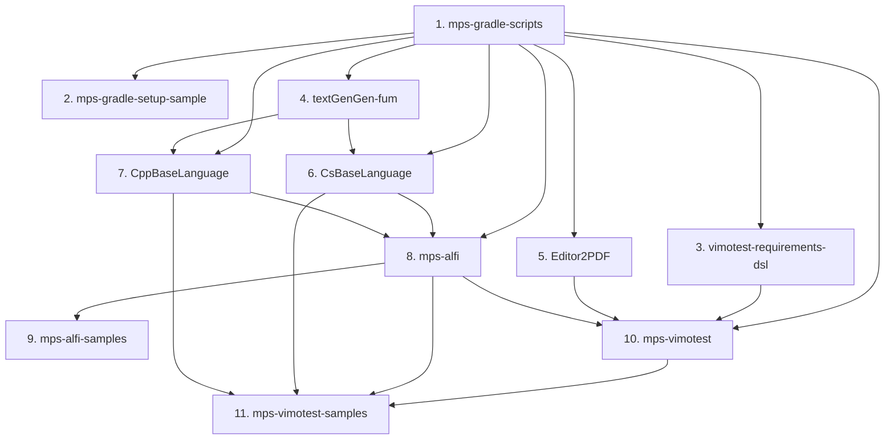

# Architecture: Hybrid Migration Orchestration

This document details the architectural design and principles behind the ViMoTest MPS hybrid migration layer.

---

## 1. Motivation: Decentralized Repositories vs. Monorepo

The ViMoTest ecosystem consists of multiple specialized JetBrains MPS languages, runtime libraries, generators, and sample projects. Each repository has its own:
- Dedicated Git commit history and semantic release cycle.
- Standalone CI/CD automation (`.github/workflows`).
- Issue tracking and distribution releases on GitHub.

A classic **monorepo** would disrupt these independent lifecycles, complicate open-source contributions, and require rewriting established CI/CD and release pipelines.

A purely **manual decentralized approach**, however, creates friction during major MPS version migrations:
- Repositories depend on one another in a strict topological order.
- Upstream plugins must be built, packaged, and made available to downstream dependencies before downstream repositories can even build or test.
- Migrating 11 repositories manually requires repetitive Gradle script updates, SDK configuration, and distribution downloads.

### The Hybrid Solution
The **hybrid orchestration layer** solves this by:
1. Retaining **100% decentralized independence** via Git submodules. Each submodule tracks its own remote repository and release history.
2. Providing a **unified local workspace** where submodules sit as siblings, allowing automated builds to resolve dependencies directly from local sibling build outputs (`build/artifacts/...`) without waiting for intermediate GitHub releases.
3. Supplying an **orchestrator CLI** (`./orchestrate`) driven by declarative dependency metadata (`repos.json`) that manages submodule initialization, script synchronization, bundle downloads, build execution, test verification, and status tracking.
4. Enabling **AI agents** to systematically traverse the dependency chain, using MPS 2026.1 native **Model Context Protocol (MCP)** tools to automate model migrations and AST repairs.

---

## 2. Dependency Graph & Topological Order

Migrations must proceed strictly along the topological dependency order:



| Order | Repository | Submodule Path | Dependencies | Artifact Output |
|:---:|---|---|---|---|
| 1 | `mps-gradle-scripts` | `mps-gradle-scripts` | *None* | Root gradle scripts provider |
| 2 | `mps-gradle-setup-sample` | `mps-gradle-setup-sample` | 1 | Verification sample |
| 3 | `vimotest-requirements-dsl` | `vimotest-requirements-dsl` | 1 | Language plugin |
| 4 | `textGenGen-fum` | `textGenGen-fum` | 1 | `build/artifacts/TextGenGen/TextGenGen.zip` |
| 5 | `Editor2PDF` | `Editor2PDF` | 1 | Utility plugin |
| 6 | `CsBaseLanguage` | `CsBaseLanguage` | 1, 4 | `build/artifacts/CsBaseLanguage/CsBaseLanguage.zip` |
| 7 | `CppBaseLanguage` | `CppBaseLanguage` | 1, 4 | `build/artifacts/CppBaseLanguage/CppBaseLanguage.zip` |
| 8 | `mps-alfi` | `mps-alfi` | 1, 6, 7 | `build/artifacts/alfi-build/alfi.zip` |
| 9 | `mps-alfi-samples` | `mps-alfi-samples` | 8 | End-to-end ALFI samples & tests |
| 10 | `mps-vimotest` | `mps-vimotest` | 1, 3, 5, 8 | `build/artifacts/mps-vimotest/mps-vimotest.zip` |
| 11 | `mps-vimotest-samples` | `mps-vimotest-samples` | 10, 8, 6, 7 | End-to-end ViMoTest sample application |

---

## 3. Dynamic Local Sibling Resolution with Remote Fallback

A core architectural pattern implemented across the orchestration layer and downstream repositories is **dynamic property-based plugin resolution**.

In standard CI or standalone developer checkouts, repositories download released dependency plugins via GitHub Release asset URLs. Within this orchestration repository, however, dependencies can be consumed immediately from sibling build artifacts as soon as they are built, avoiding circular release deadlocks—while keeping local path knowledge (`build/artifacts/...`) strictly inside the orchestration layer (`repos.json` and `./orchestrate`).

Each downstream repository uses a concise one-liner in `build.gradle` (e.g. [`mps-vimotest/build.gradle`](../mps-vimotest/build.gradle)):

```groovy
def alfiPluginUrl = project.findProperty("alfiPluginUrl") ?: "https://github.com/vimotest/mps-alfi/releases/download/2026.1.0/alfi.zip"
def cppBaseLanguagePluginUrl = project.findProperty("cppBaseLanguagePluginUrl") ?: "https://github.com/Fumapps/CppBaseLanguage/releases/download/2026.1.0/CppBaseLanguage.zip"
def csBaseLanguagePluginUrl = project.findProperty("csBaseLanguagePluginUrl") ?: "https://github.com/Fumapps/CsBaseLanguage/releases/download/2026.1.0/CsBaseLanguage.zip"

ext.customMpsPlugins = [
    "alfi": alfiPluginUrl,
    "CppBaseLanguage": cppBaseLanguagePluginUrl,
    "CsBaseLanguage": csBaseLanguagePluginUrl
]
```

Meanwhile, [`repos.json`](../repos.json) maps each provider repository's `pluginProperty` and `artifactZip`, and `./orchestrate` automatically injects `-P<pluginProperty>=file://...` whenever the local artifact exists.

### Advantages:
- **Clean decoupled repositories**: Individual repositories remain free of hardcoded relative paths (`../mps-alfi/build/artifacts/...`).
- **Zero lag**: As soon as `mps-alfi` finishes `mpsBuild`, `./orchestrate prepare mps-vimotest` immediately passes `-PalfiPluginUrl=file://...` pointing to the newly built plugin.
- **Full CI portability**: When a submodule is built standalone or on GitHub Actions without orchestrator properties, `findProperty(...)` returns `null` and automatically falls back to the published GitHub release URL.
- **Dual-Mode Verification (`--mode local` vs `--mode remote`)**: During initial migration, `--mode local` (default) resolves sibling artifacts locally. Before or after publishing upstream GitHub Releases, `--mode remote` clears cached plugin downloads and runs `./gradlew` without `-P*PluginUrl` overrides to verify the exact decentralized release URLs that CI and external users consume.

---

## 4. Shared MPS & JBR Bundle Deduplication (`.mps-shared/`)

Extracting MPS 2026.1 and JBR 25 independently inside 11 submodules would consume ~2.1 GB per repository (~23+ GB total). Because `download-mps.gradle` guards its download and extraction tasks (`downloadMps`, `buildMpsZipBundle`, `extractJbrToMpsBundle`, `copyOsSpecificBinFiles`, `buildOsSpecificBundle`) with directory existence checks (`onlyIf { !file(...).exists() }`), the orchestration layer deduplicates the MPS installation transparently:

1. **Canonical Base Bundle**: `./orchestrate` stores a single extracted MPS + JBR distribution at `.mps-shared/<mpsVersion>/Contents` (or `mps` on Linux/Windows).
2. **Per-Submodule Lightweight Links**: During `./orchestrate prepare <repo>` or `./orchestrate share-bundles`, each submodule's `build/mps-bundle/Contents` is populated with symlinks to the heavy read-only directories (`lib`, `plugins`, `jbr`, `languages`, `MacOS`, `Resources`, etc.) in `.mps-shared`.
3. **Isolated `bin/*.vmoptions` & `dependencies/`**: Each submodule receives its own lightweight copy of `bin/` (~1.1 MB) configured with `-Didea.plugins.path=<repo>/build/mps-bundle/dependencies`, and its own `dependencies/` folder where `downloadPlugins` unpacks that repository's specific plugins.

This reduces disk usage across all 11 submodules from ~24 GB to ~2.2 GB total and makes `./orchestrate prepare` complete in seconds.

---

## 5. Shared Foundation: `mps-gradle-scripts`

`mps-gradle-scripts` serves as the single source of truth for Gradle automation across all repos. It provides:
1. [`download-mps.gradle`](../mps-gradle-scripts/gradle/download-mps.gradle):
   - Maps MPS versions to JetBrains Runtime (JBR) versions (e.g. MPS 2026.1 -> JBR 25.0.3-b329.124).
   - Downloads and unpacks OS-specific MPS bundles and plugins into `build/mps-bundle`.
   - Creates backward-compatible symlinks (`build/dependencies` -> `build/mps-bundle/dependencies`).
2. [`run-mps-ant.gradle`](../mps-gradle-scripts/gradle/run-mps-ant.gradle):
   - Configures headless ANT execution using the JBR runtime.
   - Wraps `generate`, `build`, and `check` ANT targets.
   - Provides optional `-PantBuildFile=...` targeting.
3. [`init-gradle-scripts.gradle`](../mps-gradle-scripts/gradle/init-gradle-scripts.gradle):
   - Bootstraps script synchronization from the upstream repository.

