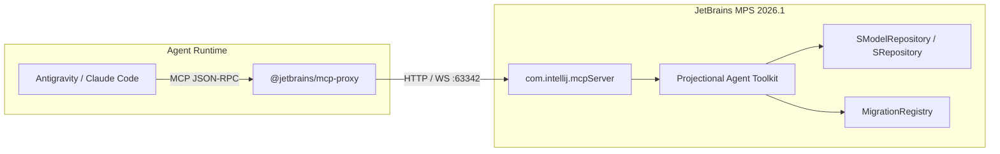

# Model Context Protocol (MCP) Integration for MPS 2026.1

JetBrains MPS 2026.1 introduces native support for the **Model Context Protocol (MCP)**, powered by the **Projectional Agent Toolkit** (`jetbrains.mps.agents.mcp.tools` built atop `com.intellij.mcpServer`).

This enables external AI coding agents (such as Antigravity, Claude Code, or custom agent runtimes) to inspect and manipulate MPS models structurally without corrupting raw `.mps` XML files.

---

## 1. Architecture Overview



### Why MCP Matters for MPS Migrations
Traditional file-based agent editing frequently corrupts MPS persistence:
- Direct XML edits can break node concept IDs (`concept="2kuSLC0kNK4"`), reference pointers, or indentation structures.
- Unsynchronized changes bypass MPS SModel internal caches and indexers.

With MCP:
- The agent communicates with the live, running MPS instance.
- Migrations are triggered through internal MPS migration APIs.
- Queries return structured node hierarchies and concepts rather than raw XML blobs.
- Modifications adhere to language structure definitions and constraints.

---

## 2. Launching and Configuring MPS for MCP

### 1. Launch MPS with the Target Project
Use the orchestrator CLI:
```bash
./orchestrate open <repo-id>
```
*This starts MPS 2026.1 using the JBR 25 runtime and automatically mounts all dependency plugins located in `build/mps-bundle/dependencies`.*

### 2. Verify MCP Server Status
Within MPS:
- Navigate to **Settings** (`Preferences` on macOS) -> **Tools** -> **MCP Server**.
- Ensure the server is **Enabled**.
- Default port is **`63342`**.

### 3. Agent Client Configuration
Add the server entry to your MCP client configuration (`mcpServers`):

```json
{
  "mcpServers": {
    "mps-2026": {
      "command": "npx",
      "args": ["-y", "@jetbrains/mcp-proxy"],
      "env": {
        "IDE_PORT": "63342"
      }
    }
  }
}
```

You can view this configuration at any time by running:
```bash
./orchestrate mcp-config <repo-id>
```

---

## 3. Available MCP Capabilities in MPS 2026.1

| Capability | Description |
|---|---|
| `run_migrations` | Executes all pending MPS version migrations and language migrations for the active project. |
| `make_model` / `make_solution` | Triggers structural make/rebuild on specified modules or models. |
| `query_nodes` | Queries nodes matching concept names or properties. |
| `inspect_ast` | Returns readable structural representations of AST subtrees. |
| `check_constraints` | Runs language constraint checkers on target nodes and reports errors. |
| `fix_broken_references` | Re-resolves broken `SReference` targets programmatically. |

---

## 4. Best Practices for MCP-Assisted Migrations

1. **Always run headless verification after MCP operations**:
   Even if an agent performs changes via MCP in the UI, always validate headless execution with `./orchestrate build <repo-id>` and `./orchestrate test <repo-id>`.
2. **Keep the IDE open during multi-step repairs**:
   The MCP proxy maintains an active session with the running instance. Do not close MPS until the agent completes AST changes and triggers *Save All* (`Cmd+S` / `Ctrl+S`).
3. **Commit submodules before switching projects**:
   Close the project or MPS before launching `./orchestrate open` on the next repository.

